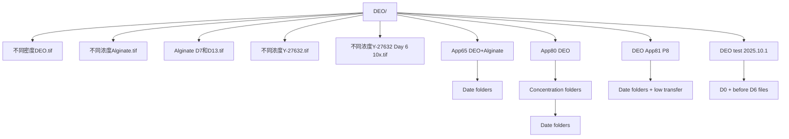
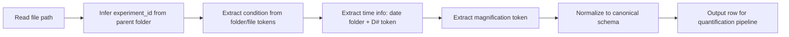

# DEO Data Structure Guide (for Quantification Pipeline)

This document explains the current DEO experiment data layout and how file/folder names encode metadata for downstream code and AI quantification.

## 1) High-level mapping (confirmed)

| Major figure | Raw data source(s) | Biological focus | Typical quantification target |
|---|---|---|---|
| `不同密度DEO.tif` | A: `DEO App81 P8`, B: `DEO test 2025.10.1` | Density effect | Growth (diameter/size) + fusion events |
| `不同浓度Alginate.tif` + `Alginate D7和D13.tif` | `App65 DEO+Alginate` | Alginate concentration effect | Growth (diameter/size) + fusion events |
| `不同浓度Y-27632.tif` + `不同浓度Y-27632 Day 6 10x.tif` | `App80 DEO` | Y-27632 concentration effect | Fusion quantification (primary) |

Reference sources:
- `references/deo_experiment_mapping_confirmed.md`
- `references/DEO+part+thesis.pdf`

## 2) Repository-level data structure

## 3) Per-experiment schema signals from names

### 3.1 App65 DEO+Alginate

- Organization: `experiment/date/*.tif`
- Date folders: 13
- Total images: 1245
- Condition labels in filename: `0.02% Alginate`, `0.05% Alginate`, `No/no`
- Magnification labels: `4x`, `10x`

### 3.2 App80 DEO (Y-27632)

- Organization: `experiment/concentration/date/*.tif`
- Concentration folders: `No`, `10uM`, `20uM`, `50uM`, `100uM`
- Total images: 923
- Magnification labels: `4x`, `10x`
- This dataset is the clearest for dose-response parsing.

### 3.3 DEO App81 P8 (Density A)

- Organization: `experiment/date/*.tif` + `low transfer/date/*.tif`
- Total images: 182 (including `low transfer`)
- Density labels in filename: `low`, `middle`, `high`
- Magnification labels: `4x`, `10x`

### 3.4 DEO test 2025.10.1 (Density B)

- Organization: `experiment/D0/*.tif` plus top-level `before D6-*.tif`
- Total images: 140
- Name tokens include density-like labels: `low`, `middle`, `high`
- Magnification-like labels: mostly `10X`, `4X`, some `2X`
- Timepoint tokens embedded in filename (e.g., `D1`, `D6`, `D20`, `D23`)

## 4) Suggested canonical metadata fields for code/AI

Use a parser that extracts these fields from path + filename:

| Field | Example | Source |
|---|---|---|
| `experiment_id` | `app65_alginate`, `app80_y27632`, `app81_density_A`, `test2025_density_B` | folder mapping |
| `major_figure` | `density`, `alginate`, `y27632` | confirmed mapping |
| `part` | `A`, `B`, `single` | density experiment split |
| `condition` | `0.02%`, `50uM`, `low` | folder/file token |
| `condition_unit` | `%`, `uM`, `level` | token normalization |
| `date_folder` | `29-十一月-2025` | path segment |
| `day_token` | `D6`, `D13` | filename token |
| `magnification` | `4x`, `10x`, `2x` | filename token |
| `rgb_flag` | `true/false` | `_RGB` token |
| `file_path` | absolute path | filesystem |

## 5) Practical parsing strategy

## 6) Notes for quantification design

- Growth metrics (diameter/area) should be first-class for Density + Alginate experiments.
- Fusion metrics are required for all three, but primary endpoint for Y-27632.
- `DEO test 2025.10.1` has noisier naming; build regex-based parser with fallback review queue.
- Keep raw image data immutable; write only derived tables and analysis outputs.
