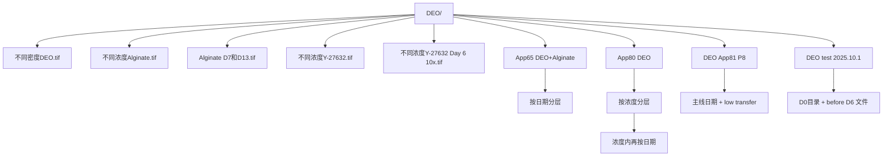
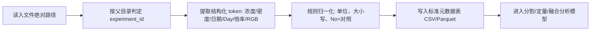

# DEO 数据结构与命名规则（中文版｜详细）

本文用于后续代码与 AI 定量分析设计，目标是把“目录结构 + 文件名”转换为稳定元数据。

## 1. 三大实验与汇总图对应（已确认）

| 实验主题 | 汇总图 | 原始数据目录 | 主要定量目标 |
|---|---|---|---|
| 不同密度 DEO | `不同密度DEO.tif` | A: `DEO App81 P8`；B: `DEO test 2025.10.1` | 生长（直径/面积/大小）+ 融合 |
| 不同浓度 Alginate | `不同浓度Alginate.tif`，`Alginate D7和D13.tif` | `App65 DEO+Alginate` | 生长（直径/面积/大小）+ 融合 |
| 不同浓度 Y-27632 | `不同浓度Y-27632.tif`，`不同浓度Y-27632 Day 6 10x.tif` | `App80 DEO` | 融合定量（主） |

参考：`references/deo_experiment_mapping_confirmed.md`、`references/DEO+part+thesis.pdf`

## 2. 全局目录结构（Mermaid）

## 3. 各实验内层结构与统计

### 3.1 App65 DEO+Alginate（Alginate）

结构模式：`App65 DEO+Alginate/<日期>/*.tif`

- 日期目录数：13
- 图像总数：1245
- 文件名条件关键词：`0.02% Alginate`、`0.05% Alginate`、`No/no`
- 倍率关键词：`4x`、`10x`

关键词计数（文件名解析）：
- `0.02%`: 355
- `0.05%`: 357
- `No`: 454
- `4x`: 359
- `10x`: 886

说明：少量文件落入 `other`（命名不完全规范），建议保留人工校对队列。

### 3.2 App80 DEO（Y-27632）

结构模式：`App80 DEO/<浓度>/<日期>/*.tif`

- 浓度目录：`No`, `10uM`, `20uM`, `50uM`, `100uM`
- 日期目录（各浓度下）：`05,07,08,09,10,11,12-十二月-2025`
- 图像总数：923
- 倍率关键词：`4x`、`10x`

各浓度图像数：
- `No`: 143
- `10uM`: 200
- `20uM`: 185
- `50uM`: 194
- `100uM`: 201

该实验目录语义最清晰，适合作为解析器基准模板。

### 3.3 DEO App81 P8（密度 A）

结构模式：
- 主线：`DEO App81 P8/<日期>/*.tif`
- 转移阶段：`DEO App81 P8/low transfer/<日期>/*.tif`

- 图像总数：182（含 low transfer 47 张）
- 密度标签关键词：`low`, `middle`, `high`
- 倍率关键词：`4x`, `10x`

注意：`low transfer` 中有一部分文件不含 `low/middle/high` 标签（仅有倍率或编号），解析时需允许 `density_label = null`。

### 3.4 DEO test 2025.10.1（密度 B）

结构模式：
- `DEO test 2025.10.1/D0/*.tif`
- `DEO test 2025.10.1/before D6-*.tif`（顶层文件）

- 图像总数：140
- 常见前缀组：
- `4well 1x low`（41）
- `4well 5x middle`（22）
- `4well 10x high`（30）
- `4well 10x high left about 5x`（29）
- `before D6-*`（16）

时间 token（文件名中的 `D#`）覆盖 `D1` 到 `D23`。

关键语义：
- 前缀里的 `1x/5x/10x` 更像“分组/密度级别标签”（不是显微倍率）。
- 文件名后半段 `4X/10X/2X` 才是显微倍率 token。

## 4. 文件名模式与元信息含义（核心）

| 模式/Token | 示例 | 建议字段 | 语义说明 |
|---|---|---|---|
| 浓度目录 | `50uM` | `condition_value=50`, `condition_unit=uM` | Y-27632 浓度组 |
| `No` | `App80/No/...` 或文件名 `no` | `control_flag=true` | 对照组（无添加） |
| 百分比浓度 | `0.02% Alginate` | `condition_value=0.02`, `condition_unit=%` | Alginate 浓度 |
| 密度标签 | `low/middle/high` | `density_label` | 密度分组 |
| 日期目录 | `29-十一月-2025` | `date_folder_raw` | 采集日期（中文月） |
| Day token | `D7`, `D13`, `D6` | `day_token` | 培养天数标记 |
| 显微倍率 | `4x`, `10X`, `2X` | `magnification` | 成像倍率 |
| RGB 标记 | `_RGB` | `rgb_flag=true` | RGB 图像或导出版本 |
| transfer 路径 | `low transfer` | `phase=transfer` | 转移阶段数据 |

## 5. 推荐正则（代码解析可直接用）

- Day token：`\bD(?P<day>\d+)\b`
- 倍率：`\b(?P<mag>2|4|10)[xX]\b`
- Alginate 百分比：`(?P<alg>0\.0[25])%`
- Y-27632 浓度目录：`^(?P<conc>No|10uM|20uM|50uM|100uM)$`
- 密度标签：`\b(?P<density>low|middle|high)\b`（忽略大小写）
- RGB：`_RGB\b`

## 6. 统一元数据字段（建议输出表）

| 字段 | 说明 |
|---|---|
| `experiment_id` | `app65_alginate` / `app80_y27632` / `app81_density_A` / `test2025_density_B` |
| `major_figure` | `density` / `alginate` / `y27632` |
| `part` | `A` / `B` / `single` |
| `condition_raw` | 原始条件字符串（如 `0.02% Alginate`, `50uM`, `low`） |
| `condition_type` | `alginate_percent` / `y27632_uM` / `density_level` |
| `condition_value` | 数值化条件（如 `0.02`, `50`） |
| `condition_unit` | `%` / `uM` / `level` |
| `date_folder_raw` | 原始日期目录名 |
| `day_token` | 文件名中的 `D#` |
| `magnification` | `2x` / `4x` / `10x` |
| `rgb_flag` | 是否 `_RGB` |
| `phase` | `main` / `transfer` / `before_d6` |
| `file_path` | 原始绝对路径 |

## 7. 解析流程（Mermaid）

## 8. 面向定量分析的建议

- 生长指标（直径、面积、圆度）优先用于 `密度 + Alginate`。
- 融合指标（融合事件数、融合比例、融合时间点）三类实验都做，`Y-27632` 作为主终点。
- `DEO test 2025.10.1` 命名噪声较高，必须加“低置信度样本人工复核”步骤。
- 原始 `DEO/` 文件保持只读，所有派生结果写到新目录（如 `analysis/`）。
