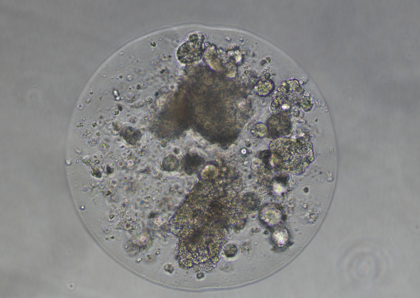
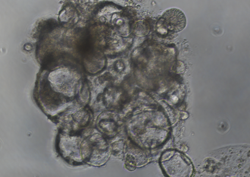
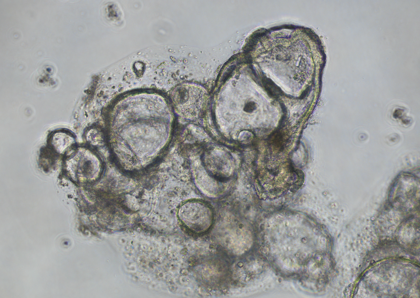
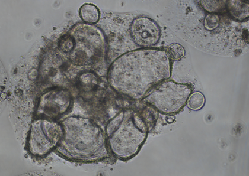
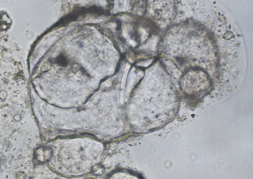
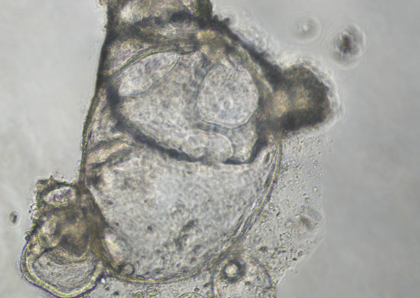
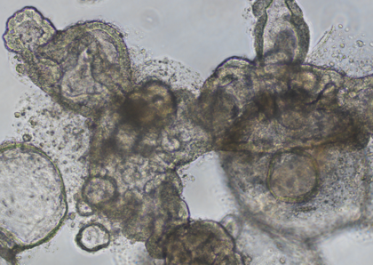

# Blind Fusion Cohort Report: Set 001

This report orders the blinded UID images by their private source-date mapping and presents the refined fusion-analysis values with justification.

Important: the prompt tool itself did not see the date or condition metadata; this ordering was reconstructed afterward from the private mapping file.

## Cohort Summary

- Images: `7`
- Fusion ranking (strongest to weakest): `uid_4c9aeeaf4c2a, uid_b7994011c9ae, uid_bcb41b6edfeb, uid_5cd5b219af3c, uid_8df5c90572c3, uid_0184600f4483, uid_4a5bcda58697`
- Review note: Second-pass visual review mostly confirms the draft. Main refinement is stricter separation of irregular dark coalesced phenotypes (late_irregular_fused_mass) from large but still cystic multi-lobed continuity (advanced_fusion); only uid_4c9aeeaf4c2a and uid_b7994011c9ae meet late-irregular criteria.
- Analysis note: Cohort spans partial-to-late fusion states. Two fields show dominant irregular dark coalesced tissue with reduced internal separability, while most others retain multi-lobed cystic architecture with visible septa/boundaries and peripheral satellites, consistent with moderate-to-advanced fusion rather than terminal irregular collapse.

## Day-Ordered Detail

### Sequence Day 1

- UID: `uid_4c9aeeaf4c2a`
- Source date: `05-十二月-2025`
- Relative calendar offset from first source date: `0` day(s)
- Original source basename: `10x00.tif`
- Fusion ranking position: `1`
- Fusion score: `5`
- Fusion state: `late_irregular_fused_mass`
- Estimated organoid units: `8`
- Largest mass relative: `83`
- Size relative: `55`
- Perimeter complexity: `74`
- Confidence: `0.89`
- Prior consistency note: Kept consistent with prior and remains top-ranked for fusion severity.

Justification:
- Summary: Loss of clear internal separability with dominant irregular coalesced mass supports late irregular fused state.
- Relative position: Within a circular droplet boundary, irregular dark connected tissue dominates central area with smaller peripheral bodies.
- Texture/color: Markedly dark, thickened, heterogeneous, partially wrinkled/compacted appearance.
- Large connected mass present: `True`
- Multiple separate round units present: `True`
- Visible boundaries between units: `False`
- Irregular/thickened/collapsed regions present: `True`

### Sequence Day 2

- UID: `uid_b7994011c9ae`
- Source date: `07-十二月-2025`
- Relative calendar offset from first source date: `2` day(s)
- Original source basename: `10X00.tif`
- Fusion ranking position: `2`
- Fusion score: `4.5`
- Fusion state: `late_irregular_fused_mass`
- Estimated organoid units: `10`
- Largest mass relative: `73`
- Size relative: `76`
- Perimeter complexity: `86`
- Confidence: `0.84`
- Prior consistency note: Refined upward in score while retaining late_irregular_fused_mass label; strict review confirms stronger irregular coalescence than advanced cystic-only cases.

Justification:
- Summary: Substantial irregular coalesced core with reduced separability places this between advanced and maximal late-irregular fusion.
- Relative position: Dense central connected tissue dominates with embedded and peripheral smaller round units.
- Texture/color: Dark, compacted, heterogeneous internal texture with partial boundary loss across the core.
- Large connected mass present: `True`
- Multiple separate round units present: `True`
- Visible boundaries between units: `False`
- Irregular/thickened/collapsed regions present: `True`

### Sequence Day 3

- UID: `uid_0184600f4483`
- Source date: `08-十二月-2025`
- Relative calendar offset from first source date: `3` day(s)
- Original source basename: `10x00.tif`
- Fusion ranking position: `6`
- Fusion score: `3`
- Fusion state: `moderate_fusion`
- Estimated organoid units: `10`
- Largest mass relative: `53`
- Size relative: `78`
- Perimeter complexity: `73`
- Confidence: `0.82`
- Prior consistency note: Kept consistent with prior; morphology supports moderate connected coalescence with still-discernible unit boundaries.

Justification:
- Summary: Connected aggregate is clear, but multiple unit contours remain visible; moderate fusion is best fit.
- Relative position: Cluster contains several large contacting lobes with smaller round satellites around the left/lower margins.
- Texture/color: Predominantly translucent cystic interiors with mild heterogeneous darker base material.
- Large connected mass present: `True`
- Multiple separate round units present: `True`
- Visible boundaries between units: `True`
- Irregular/thickened/collapsed regions present: `False`

### Sequence Day 4

- UID: `uid_4a5bcda58697`
- Source date: `09-十二月-2025`
- Relative calendar offset from first source date: `4` day(s)
- Original source basename: `10x00.tif`
- Fusion ranking position: `7`
- Fusion score: `2`
- Fusion state: `partial_fusion`
- Estimated organoid units: `12`
- Largest mass relative: `46`
- Size relative: `82`
- Perimeter complexity: `81`
- Confidence: `0.79`
- Prior consistency note: Kept consistent with prior; this remains the least fused image in the cohort.

Justification:
- Summary: Crowded contact and local coalescence are present, yet architecture is still strongly multi-unit; partial fusion.
- Relative position: Many round cystic units are tightly packed in a common region, but separations between units are broadly preserved.
- Texture/color: Mostly cystic and round with limited compact dark collapse-like tissue.
- Large connected mass present: `True`
- Multiple separate round units present: `True`
- Visible boundaries between units: `True`
- Irregular/thickened/collapsed regions present: `False`

### Sequence Day 5

- UID: `uid_bcb41b6edfeb`
- Source date: `10-十二月-2025`
- Relative calendar offset from first source date: `5` day(s)
- Original source basename: `10x00.tif`
- Fusion ranking position: `3`
- Fusion score: `4`
- Fusion state: `advanced_fusion`
- Estimated organoid units: `6`
- Largest mass relative: `79`
- Size relative: `70`
- Perimeter complexity: `56`
- Confidence: `0.86`
- Prior consistency note: Kept label/score from prior; moved slightly higher within advanced group due stronger single-body continuity and low peripheral fragmentation.

Justification:
- Summary: Highly coalesced cystic macro-structure with remaining internal septa is most consistent with advanced fusion.
- Relative position: One dominant multi-lobed body occupies most of the field, with a small attached lower satellite.
- Texture/color: Predominantly smooth cystic lobes with broad shared walls and limited dark compacted regions.
- Large connected mass present: `True`
- Multiple separate round units present: `True`
- Visible boundaries between units: `True`
- Irregular/thickened/collapsed regions present: `False`

### Sequence Day 6

- UID: `uid_5cd5b219af3c`
- Source date: `11-十二月-2025`
- Relative calendar offset from first source date: `6` day(s)
- Original source basename: `10x00.tif`
- Fusion ranking position: `4`
- Fusion score: `4`
- Fusion state: `advanced_fusion`
- Estimated organoid units: `5`
- Largest mass relative: `77`
- Size relative: `73`
- Perimeter complexity: `61`
- Confidence: `0.85`
- Prior consistency note: Kept label/score from prior; adjusted ranking slightly below uid_bcb41b6edfeb after stricter side-by-side comparison.

Justification:
- Summary: Large continuous multi-lobed structure with residual septation indicates advanced, not late-irregular, fusion.
- Relative position: A few very large lobes share broad interfaces, with limited peripheral attachments.
- Texture/color: Mostly bright/translucent cystic tissue with smooth shared walls and little dense dark collapse.
- Large connected mass present: `True`
- Multiple separate round units present: `True`
- Visible boundaries between units: `True`
- Irregular/thickened/collapsed regions present: `False`

### Sequence Day 7

- UID: `uid_8df5c90572c3`
- Source date: `12-十二月-2025`
- Relative calendar offset from first source date: `7` day(s)
- Original source basename: `10x00.tif`
- Fusion ranking position: `5`
- Fusion score: `3`
- Fusion state: `moderate_fusion`
- Estimated organoid units: `11`
- Largest mass relative: `61`
- Size relative: `90`
- Perimeter complexity: `87`
- Confidence: `0.76`
- Prior consistency note: Kept consistent with prior; bridging architecture and heterogeneity support moderate fusion.

Justification:
- Summary: Connectedness is evident but numerous identifiable subunits persist; moderate fusion with irregular features.
- Relative position: Two larger regions are connected by a tissue bridge, with many smaller cysts in and around the bridge.
- Texture/color: Mixed translucent cysts and darker thickened strands/patches.
- Large connected mass present: `True`
- Multiple separate round units present: `True`
- Visible boundaries between units: `True`
- Irregular/thickened/collapsed regions present: `True`

